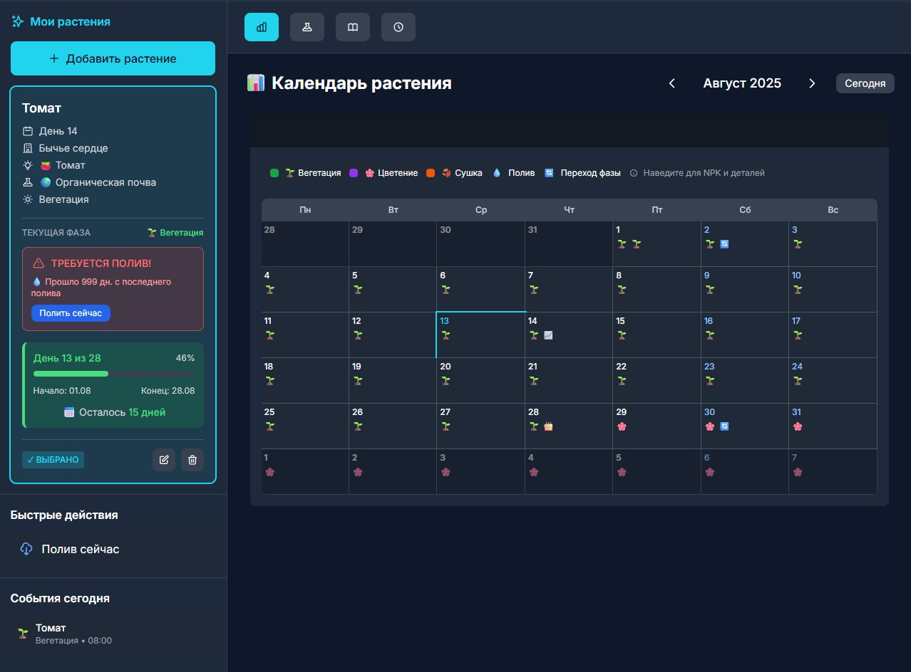
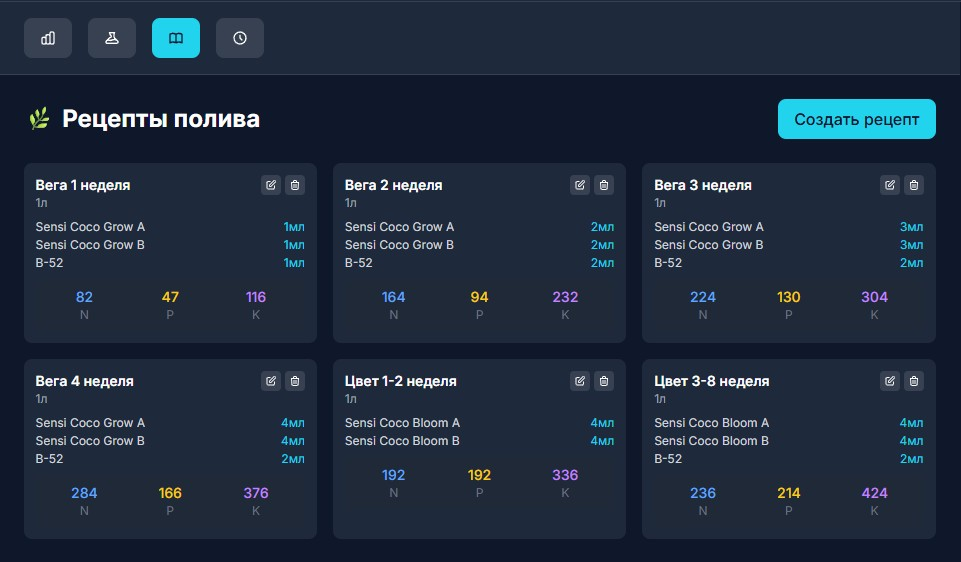
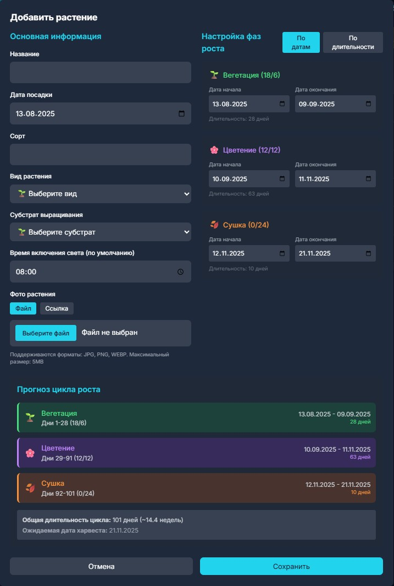
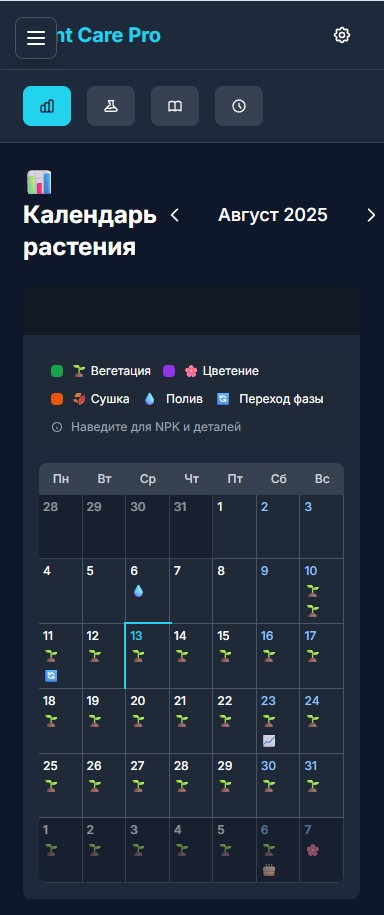

# 🌱 Plant Care Pro

Профессиональная веб-система для ухода за комнатными растениями с интуитивно понятным интерфейсом и мощными возможностями отслеживания.

## 📸 Скриншоты
<div align="center">
  
  
  
  
</div>

## ✨ Основные возможности

### 📊 Управление растениями

* **Каталог растений**: Добавление, редактирование и удаление растений
* **Детальные профили**: Фото, название, тип, местоположение и заметки
* **Календарь ухода**: Автоматические напоминания о поливе, удобрении и пересадке
* **История действий**: Полный журнал всех операций по уходу

### 📅 Планирование и напоминания

* **Календарь событий**: Визуальный календарь с предстоящими задачами
* **Умные напоминания**: Автоматический расчет следующего полива
* **Быстрые действия**: Мгновенная отметка выполненных операций
* **Статистика**: Аналитика и графики активности ухода

### 🎨 Современный интерфейс

* **Темная тема**: Стильный темный дизайн с акцентными цветами
* **Адаптивность**: Полная поддержка мобильных устройств
* **Интуитивность**: Простая навигация и понятные элементы управления
* **Производительность**: Быстрая работа и плавные анимации

## 🚀 Технические особенности

### Архитектура

* **Node.js сервер**: рендерит страницу из шаблонных блоков и раздает статические ресурсы
* **Vanilla JavaScript**: клиентская логика без фреймворков, максимальная производительность
* **IndexedDB**: основное локальное хранилище растений, поливов, удобрений и рецептов
* **LocalStorage fallback**: аварийное сохранение и миграция старых данных
* **Modular Design**: HTML разбит на шаблонные блоки, клиентский JavaScript вынесен в отдельный файл

### UI/UX

* **Tailwind CSS**: Современная система стилизации
* **Google Fonts (Inter)**: Профессиональная типографика
* **SVG Icons**: Векторные иконки для четкого отображения
* **Responsive Layout**: Адаптация под все размеры экранов

## 📦 Установка и запуск

**1. Клонирование репозитория:**

```bash
git clone https://github.com/h47e/plant-care-pro.git
cd plant-care-pro
```

**2. Запуск приложения:**

Приложение запускается через Node.js сервер. В проекте нет внешних npm-зависимостей, поэтому установка нужна только для стандартного npm workflow и проверки lock-файла.

```bash
npm install
npm start
```

После запуска откройте `http://localhost:3000`.

**3. Требования:**

* Node.js 18+
* Современный веб-браузер
* JavaScript включен
* Поддержка IndexedDB (LocalStorage используется как резервный fallback)

## 🌟 Использование

### Добавление растения

1. Нажмите кнопку "Добавить растение"
2. Заполните форму с информацией о растении
3. Установите расписание полива и удобрений
4. Сохраните изменения

### Управление уходом

1. Выберите растение из списка
2. Просмотрите текущий статус и предстоящие задачи
3. Отметьте выполненные действия
4. Просматривайте историю в календаре

### Настройки

* Персонализация напоминаний
* Настройка интервалов ухода по умолчанию
* Управление уведомлениями

## 🎯 Структура проекта

```
plant-care-pro/
├── server.js                         # Node.js HTTP сервер и простой рендер include-блоков
├── package.json                      # npm scripts и требования к Node.js
├── index.html                        # Подсказка для запуска через Node.js
├── public/
│   └── js/app.js                     # Клиентская логика приложения
├── src/views/
│   ├── index.ejs                     # Главный шаблон страницы
│   └── partials/                     # Блоки интерфейса
│       ├── head.ejs
│       ├── header.ejs
│       ├── sidebar.ejs
│       ├── main-content.ejs
│       └── modals/                   # Модальные окна растения, полива, удобрений и рецептов
├── images/                           # Скриншоты и изображения README
└── README.md                         # Документация проекта
```

## 🛠 Архитектура кода

### Основные компоненты

* **Node.js renderer**: простой сервер на `http`, который собирает страницу из `src/views` и раздает `public`/`images`
* **PlantCareDatabase**: единый слой хранения в IndexedDB с fallback на LocalStorage
* **PlantManager**: Управление данными растений
* **EventManager**: Система событий и напоминаний
* **UIManager**: Управление интерфейсом
* **CalendarRenderer**: Отрисовка календаря
* **FormHandlers**: Обработка форм

### Хранение данных

Приложение хранит единый снимок состояния в браузерной базе **IndexedDB** (`plant-care-pro` → `app-state`). При первом запуске старые данные из `plantCareData` в LocalStorage автоматически мигрируют в IndexedDB. Если IndexedDB недоступна, приложение продолжит работать через LocalStorage fallback.

```javascript
// Упрощенная структура данных приложения
{
  plants: {},          // карточки растений, фазы роста и параметры света
  fertilizers: {},     // база удобрений с NPK, плотностью и изображениями
  recipes: {},         // рецепты питания с дозировками удобрений
  wateringHistory: {}, // журнал поливов по растениям, объему и рецепту
  lightPhases: {},     // календарь фаз света/роста
  settings: {}         // настройки приложения и интеграций
}
```

## 🎨 Дизайн система

### Цветовая палитра

* **Primary**: `#22D3EE` (Cyan)
* **Secondary**: `#0891B2` (Dark Cyan)
* **Dark**: `#1E293B` (Slate)
* **Darker**: `#0F172A` (Dark Slate)
* **Accent**: `#10B981` (Emerald)

### Типографика

* **Шрифт**: Inter (Google Fonts)
* **Веса**: 300, 400, 500, 600, 700

## 📄 Лицензия

MIT
